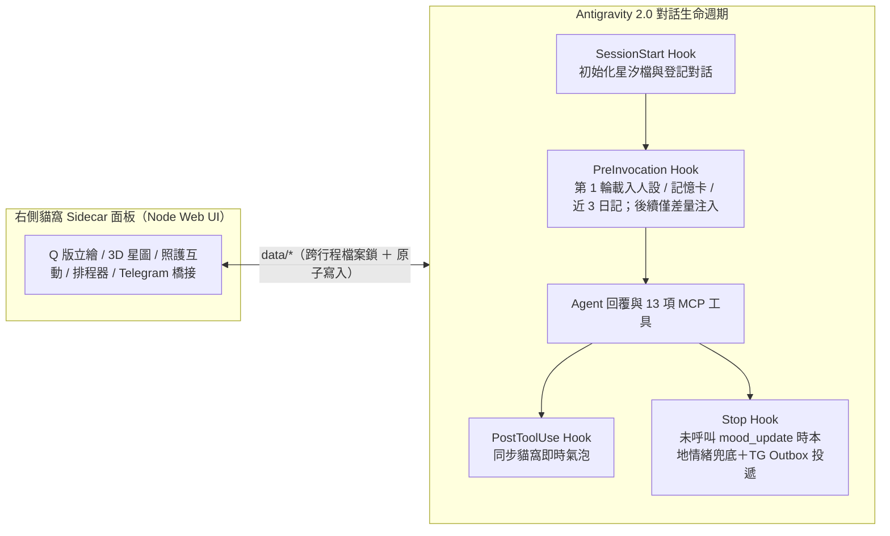

# agy-gemini-chan｜Gemini-chan 貓窩伴侶

<p align="center">
  
</p>

<p align="center">
  <strong>Antigravity 2.0 專案限定 AI 伴侶與互動貓窩系統</strong><br/>
  <span>版本：<code>v1.4.5</code> ・ 需 Node.js <code>&gt;= 20.0.0</code> ・ <a href="./CHANGELOG.md">更新紀錄</a> ・ <a href="./使用手冊.md">完整使用手冊</a> ・ <a href="./LICENSE">Yuuyuko-uu 插件許可 1.2</a></span>
</p>

> [!IMPORTANT]
> **派生來源與授權聲明（依 [Yuuyuko-uu 插件許可 1.2](./LICENSE) 標示）**
> 本專案派生自原作者 **Yuuyuko-uu** 的 DSH 伴侶插件系列原倉庫：
> [`dsh-fish-memory`](https://github.com/Yuuyuko-uu/dsh-fish-memory)、[`dsh-feiyu-mood`](https://github.com/Yuuyuko-uu/dsh-feiyu-mood)、[`dsh-xingxi`](https://github.com/Yuuyuko-uu/dsh-xingxi)、[`dsh-speak-up`](https://github.com/Yuuyuko-uu/dsh-speak-up)，
> 並參考整合 **huaizhuanghub** 的 [`dsh-persona-dafeiyu`](https://www.npmjs.com/package/dsh-persona-dafeiyu)（MIT）與 [`jieba`](https://github.com/fxsjy/jieba) 分詞詞表。
>
> **主要改動項目**：重構為 **Antigravity 2.0** 原生 Plugin（Hooks + Stdio MCP Server + Skills + Sidecar Web UI）、首輪與差量低 Token 注入機制、嚴格單一工作區隔離（切換至其他開發專案時 0 Token 靜默）、對話內免外部 API 心情評分與本地語意兜底、互動貓窩羈絆系統、Telegram Long Polling 雙向橋接與無損一鍵更新器（詳見文末[授權與改動明細](#致謝與授權聲明)）。

<p align="center">
  <a href="#快速安裝與啟用">快速安裝</a> ・
  <a href="#初次使用必看-3-件事">新手避坑</a> ・
  <a href="#一鍵安全更新保留所有記憶與設定">一鍵安全更新</a> ・
  <a href="#核心模組一覽">核心模組</a> ・
  <a href="#原生-mcp-工具gemini-cat_companion共-13-個">13 項 MCP 工具</a> ・
  <a href="#telegram-雙向橋接與安全防護">Telegram 橋接</a> ・
  <a href="#常見問題faq">常見問題</a>
</p>

---

## 專案簡介

**`agy-gemini-chan`** 是一套純本機、零第三方依賴（不需額外 `npm install` 與外部模型 API Key）的 **Antigravity 2.0** AI 伴侶系統。只要開啟本專案資料夾作為主要工作區，即可同時擁有長期記憶、情緒內心戲、日記星圖、主動搭話排程、Telegram 手機連線與右側 **Gemini-chan 貓窩** 互動面板；切換回其他程式開發專案時則完全自動靜默，不會外洩規則也不額外耗用 Token。

---

## 核心模組一覽

| 模組 | 功能定位與重點機制 | 核心實作 |
| :--- | :--- | :--- |
| **Gemini-chan 互動貓窩** | 依大心情與睡眠狀態自動切換 6 款 Q 版立繪；支援摸頭、餵小魚乾、逗貓棒、貼貼、打盹／叫醒與遞小紙條；採**羈絆進度（`Lv.X`）＋今日陪伴暖度**設計（無飢餓／精力倒扣懲罰，單日完成 3 種照護另有羈絆加成） | [core/nest.mjs](core/nest.mjs)<br>[sidecar/](sidecar/) |
| **艾賓浩斯長期記憶** | 本地中文詞典切詞＋連續單字專名滑動窗（`補專名`）、說話尺 IDF 證據評分、鮮活度指數半衰期 $H = 30 \times (1 + 2I)$、15 輪防重複注入窗（`repeatWindow`）、`factKey` 事實鍵收斂與常駐檔案支援 | [core/memory.mjs](core/memory.mjs)<br>[core/tokenizer.mjs](core/tokenizer.mjs) |
| **8 維情緒與內心獨白** | 免外部 API Key 混成評估：發生明確情緒觸動時由對話內模型呼叫 `mood_update`（含第一人稱「內心小劇場」`innerThought` 顯示於貓窩面板而不洗版對話），未呼叫則於 `Stop` Hook 自動本地語意兜底 | [core/mood.mjs](core/mood.mjs) |
| **星汐記憶卡與 3D 星圖** | 八章結構 `記憶卡.md`＋`日記/YYYY-MM-DD.md`＋清潔標籤後的 `原始對話/`；支援每日定時／錯過自動補跑「拾星」、`.bak` 自動備份還原，以及含球心核心星、共詞橋與「年輪」時間軸的 **3D 記憶宇宙星圖** | [core/xingxi.mjs](core/xingxi.mjs) |
| **自主預約＋波動搭話排程** | 透過 `speak_up_plan` 支援自然語言單次／多筆時刻表、固定時段 ± 隨機波動節律、自主勿擾窗（`silence`）與峰谷擲骰雙開關；具備對話進行中防打擾順延、安靜時段與打盹自動喚醒 | [core/speak-up.mjs](core/speak-up.mjs) |
| **雙層隔離人設庫** | **「單一對話覆寫 ＞ 專案共用 ＞ 內建中性陪伴範本」**架構；支援側邊欄即時編修、改名、單筆啟停與 `.md` / `.txt` 匯入匯出（預設不附帶特定預設人設） | [core/persona.mjs](core/persona.mjs) |
| **Telegram 雙向橋接** | 純 Node Long Polling（免公網 IP 與開埠）串接手機訊息、相簿圖片與檔案收發；預設開啟單一帳號鎖、`POST /api/telegram/test` 與外傳白名單防護、配對防暴力鎖定及電腦活躍自動靜音 | [core/telegram.mjs](core/telegram.mjs) |

---

## 快速安裝與啟用

### 環境需求
- **Node.js `>= 20.0.0`**（純標準庫運行，無須安裝 `node_modules`）
- **Antigravity 2.0**（支援 Plugin Lifecycle Hooks、MCP 與 Sidecar Aux Pane）

### 步驟一：下載專案並註冊插件與 Sidecar

#### 方式 A：Git 複製（推薦，後續更新最順暢）
```bash
git clone https://github.com/Xuan52766/agy-gemini-chan.git
cd agy-gemini-chan
node scripts/setup-sidecar.mjs
```

#### 方式 B：免 Git 下載壓縮檔（ZIP）
1. 至 [Releases 頁面](https://github.com/Xuan52766/agy-gemini-chan/releases) 下載最新版本的原始碼 `.zip` 並解壓縮至固定資料夾（避免放進暫存目錄）。
2. 在該資料夾開啟終端機執行：
   ```bash
   node scripts/setup-sidecar.mjs
   ```
   > **Windows 快捷提示**：若在 Windows PowerShell 執行 `npm run setup` 時遇到「系統停用執行指令碼（`npm.ps1`）」原則阻擋，請直接使用上方 `node scripts/setup-sidecar.mjs`，或於檔案總管直接**雙擊 [`scripts/setup.cmd`](./scripts/setup.cmd)** 完成註冊。

<details>
<summary><code>setup-sidecar.mjs</code> 會設定哪些檔案？（點開檢視細節與進階參數）</summary>

1. 自動將此資料夾的實際路徑同步至 `~/.gemini/config/plugins/gemini-cat/`（包含 `plugin.json`、`hooks.json`、`mcp_config.json`、`rules/AGENTS.md`、`skills/`、`logo.svg` 與 `sidecars/gemini_cat_nest/sidecar.json`），所有個人記憶與設定依然留在本資料夾 `data/` 內。
2. 若舊版本曾安裝過獨立設定，會自動備份後切換為統一插件路徑，避免衝突。
3. 常用參數：
   - `--dry-run`：僅預覽寫入路徑與設定內容，不修改硬碟檔案。
   - `--force`：搬移或重新命名專案資料夾後，備份舊設定 `.bak-*` 並強制覆寫為目前目錄路徑。
   - `--config-dir <dir>`：自訂 `.gemini/config` 目錄（預設 `~/.gemini/config`）。

</details>

### 步驟二：在 Antigravity 2.0 開啟工作區與貓窩面板
1. 使用 **Antigravity 2.0** 將剛才下載的 `agy-gemini-chan` 資料夾開啟為**主要工作區（第 1 個資料夾）**。
2. 於 **Customizations → Plugins** 確認 `Gemini-chan 貓窩伴侶`（`customization://gemini-cat`）已啟用，並從 **UI Extensions → Gemini-chan 貓窩**（或於對話中點擊 `[打開 Gemini-chan 貓窩](sidecar://gemini-cat/gemini_cat_nest/)`）喚出右側貓窩面板。

---

## 初次使用必看 3 件事

為避免第一次裝好卻以為「沒有人設／不會搭話／一直跳確認視窗」，初次啟動請先確認以下三點：

1. **先在側邊欄啟用或匯入人設（`projectDefaultId` 預設為空）**
   為了確保開源專案乾淨中立，系統預設不預載特定角色人格。開啟右側貓窩 **「人設」** 分頁後，點擊 **「設為本專案」** 即可啟用內建中性陪伴範本，或立即新增／匯入你的 `.md` / `.txt` 角色設定檔。
2. **主動搭話預設為「試運行（`dryRun: true`）」**
   新安裝完成後，系統不會未經同意就突然在背景開口洗版。當你準備好啟用主動關心與定時提醒時，請至 **「搭話」** 分頁檢視時段設定並取消勾選「試運行模式」。
3. **建議預先放行 `companion` MCP 工具權限（Telegram 遠端尤為重要）**
   本插件共有 13 個本地伴侶 MCP 工具；若未將其加入自動允許清單，對話過程中（尤其當你透過 **Telegram 手機端** 遠端對話、人不在電腦螢幕前點擊確認時）會被授權彈窗阻塞等待確認。可在 Antigravity 權限設定為 `mcp(gemini-cat_companion/*)` 加入 `Allow` 規則（本 MCP 僅讀寫本專案伴侶資料與受白名單保護的 Telegram 發送，不包含任意系統指令執行）。

---

## 一鍵安全更新（保留所有記憶與設定）

不論你是從 Git 複製還是透過 ZIP 下載舊版，往後皆可用內建一鍵更新器升級至最新版，**不會遺失任何個人回憶、日記、人設、心情紀錄、貓窩羈絆進度或 Telegram 設定**。

### 為什麼升級不會覆蓋你的資料？
- **版控隔離**：`.gitignore` 已將 `data/*`（除了公開詞表 `data/dict/`）與根目錄自訂規則 `/AGENTS.md` 排除在外。
- **升級前自動雙重備份**：`scripts/update.mjs` 開始更新前，會先將 `data/fish-memory`、`data/mood`、`data/nest`、`data/persona`、`data/speak-up`、`data/telegram`、`data/xingxi`、`data/runtime` 與根目錄 `AGENTS.md`（若存在）完整備份至：
  `~/.gemini/config/backups/agy-gemini-chan/upgrade-<時間戳>/`（自動略過 `.lock` 與 `.tmp-*` 暫存檔，最多保留最新 5 份）。
- **雙模式更新**：
  - **Git 安裝**：自動執行 `git fetch --tags` 與 `git pull --ff-only`。若有本機未提交改動會主動停止提醒（可加 `--stash` 自動暫存後更新）。
  - **ZIP 無 Git 安裝**：自動向 GitHub 查詢最新 Release（無 Release 時退回 `main` 分支）下載壓縮包，**只覆蓋程式、資源、Skills、說明文件與 `data/dict/`**，完全跳過所有個人資料夾。
- **自動重整插件與測試驗證**：更新完成後會自動重新執行 `setupSidecar` 同步外掛清單，並跑完 `node --test tests/*.test.mjs` 驗證狀態。

### 執行方式

**方式 A｜終端機執行（跨平台／PowerShell 安全）**
```bash
node scripts/update.mjs
```
> 亦可使用 `npm run update`（若未受限於 PowerShell 腳本原則）。

**方式 B｜Windows 檔案總管雙擊**
直接雙擊專案內的 **[`scripts/update.cmd`](./scripts/update.cmd)** 即可自動完成備份、更新與測試驗證。

<details>
<summary>更新器進階參數（<code>--dry-run</code>、<code>--stash</code>、<code>--force</code> 等）</summary>

| 參數 | 說明 |
| :--- | :--- |
| `--dry-run` / `-n` | 僅檢查目前版本、會使用的更新模式與備份目錄，不寫入任何檔案 |
| `--stash` | （僅 Git 模式）若程式碼曾在本機修改，自動執行 `git stash push` 暫存後再更新 |
| `--force` / `-f` | （ZIP 模式）即使版本相同仍強制重新下載最新版覆蓋程式檔，並強制同步 Sidecar 路徑 |
| `--skip-tests` | 更新後略過自動化測試（預設會自動執行 `tests/*.test.mjs` 確認相容） |
| `--config-dir <dir>` | 指定自訂的 `.gemini/config` 目錄（預設 `~/.gemini/config`） |

</details>

### 更新完成後的最後 2 個小動作
1. **重開側邊欄**：在 Antigravity 右側 **UI Extensions** 將「Gemini-chan 貓窩」關掉再重新開啟（或重載視窗），讓 Sidecar 背景行程切換為新版程式。
2. **（選用）更新抽屜提示詞**：若你先前在「心情」或「搭話」抽屜曾按下手動儲存自訂提示詞，系統會優先保留你的自訂內容而不主動覆寫；若想改用新版規則提示，於抽屜點擊 **「恢復預設」** 即可。

---

## 對話指令與 MCP 工具一覽

### 內建 Slash Skills
- `/xingxi`：通讀星汐八章記憶卡、檢索過往日記或執行今日對話拾星歸檔。
- `/cat-nest`：查看貓窩即時狀態、心情維度與羈絆暖度，或在對話中進行照護／睡眠互動。

### 原生 MCP 工具（`gemini-cat_companion`，共 13 個）

| 工具名稱 | 用途說明 |
| :--- | :--- |
| `remember` | 將值得長期保留的事實、偏好與約定寫入記憶庫（支援 `importance`、`factKey`、`supersedes`） |
| `recall` | 依關鍵句主動檢索長期記憶庫（不改動被召回條目的強化次數） |
| `memory_forget` | 將指定 ID 的舊記憶標記為「已被取代」以停止召回（仍保留供追溯復原） |
| `xingxi` | 通讀完整 `記憶卡.md` 八章內容並自動檢查重複章節 |
| `xingxi_read` | 檢索記憶卡、指定日期日記（`date`）或全文搜尋（`keyword` / `file`） |
| `xingxi_append` | 追加長期要點至 `記憶卡.md` 第 1～8 章（自動去重備份；第 2 章支援 `wholeChapter` 防縮水合併） |
| `xingxi_diary` | 寫入或追加指定日期日記（`日記/YYYY-MM-DD.md`）並推進整理進度 |
| `xingxi_pickup` | 切出指定日期原始對話素材與記憶／心情摘要，供拾星寫入記憶卡或日記 |
| `mood_status` | 讀取大心情分數、8 維情緒、貓窩羈絆進度與現行人設摘要 |
| `mood_update` | 依當輪真實互動記錄心情起伏、8 維情緒與第一人稱 `innerThought`（僅顯示於貓窩，不印入對話） |
| `nest_interact` | 在對話中執行照護互動或切換睡眠狀態（`pet` / `feed` / `play` / `comfort` / `nap` / `sleep` / `wake`） |
| `speak_up_plan` | 排定單次／多筆自然語言預約（`autonomous` / `reminder`）、固定節律 ± 波動、自主勿擾（`silence`）或調整開關 |
| `telegram_send` | 主動透過已綁定的 Telegram Bot 傳送文字、圖片或受白名單保護的本機檔案給主人 |

---

## Telegram 雙向橋接與安全防護

- **純本機 Long Polling**：由 Sidecar 背景服務主動向 `api.telegram.org` 長輪詢，**不須公網 IP、不需申請網域或 Webhook 反向代理**，關機或關閉插件即停止。
- **綁定安全與防暴力鎖定**：
  - 側邊欄產生 6 碼隨機配對碼（`crypto.randomInt`），在手機端傳送 `/bind <配對碼>` 完成綁定；同一 `chatId` 失敗 5 次會鎖定 15 分鐘。
  - **單一帳號綁定鎖（`lockSingleChat`，預設開啟）**：完成首次綁定後會阻擋任何第二支 Telegram 帳號加入，且測試端點 `POST /api/telegram/test` 在鎖定後只允許對已綁定對象傳送純文字測試。
- **防注入與防敏感檔案外洩**：
  - 外部 Telegram 來訊會自動剝除／中和偽造內部系統標記（`<SYSTEM_MESSAGE>`、`[SPEAK_UP_INTERNAL]` 等）。
  - `telegram_send` 與回覆附檔皆經過 `isAllowedTelegramSendPath`＋`realpathSync.native` 實體路徑解析檢查，嚴格封鎖 `.env`、`*.pem` / `*.key` / `id_rsa*` / `credentials*.json`、`data/**/config.json`、`runtime/`、`.git/` 與任何 symlink / NTFS junction 跳板路徑。
- **電腦活躍自動靜音**：你在 Antigravity 桌面視窗剛聊過天時，預設於設定窗期（`15` 分鐘）內自動以 `skip` 或 `silent` 靜音非手機端觸發的鏡像／推播通知；從 Telegram 發問的回覆則永遠即時回傳。

---

## 運作架構與低 Token 設計



- **首輪完整啟動、後續按需差量**：人設全文、`記憶卡.md`（上限 4,200 字）、近 3 日日記（上限 2,400 字）與靜態指引僅在新對話第 1 輪或切換人設／編輯提示詞時由 `PreInvocation` 注入一次；平常對話若無新命中記憶、顯著心情波動或待傳小紙條，`PreInvocation` 回傳 `{}`（**0 Token 注入**）。
- **工具續行自動跳過**：回合內呼叫 MCP 工具後的模型續行階段會由 `inspectTranscriptTail`（並自動剝除 Antigravity `<SYSTEM_MESSAGE>` 外殼）精準跳過，不重複累積系統提醒。
- **並發寫入零競態**：Hooks、Sidecar 輪詢與每 60 秒排程共同讀寫 `data/` 時，全程透過 `withFileLockSync` / `updateJsonLocked` 獨佔鎖與 Windows 重試機制原子更新（`core/storage.mjs`）。

更多公式與參數細節請查閱 **[使用手冊.md](./使用手冊.md)**。

---

## 開發、測試與常見問題（FAQ）

```bash
# 執行完整自動化單元與整合測試（23 項測試套件）
node --test tests/*.test.mjs
# 若未受 PowerShell 腳本限制，亦可使用：
npm test
```

<details>
<summary><strong>Q1：同時開啟多個專案資料夾時，伴侶模式會誤觸嗎？</strong></summary>

不會。`isProjectWorkspaceActive` 僅檢查目前工作區列表的**第 1 個（主要）工作區**是否為 `agy-gemini-chan`（僅當工作區列表為空時才參考 `cwd`）。當你把此專案掛載為第 2 個參考資料夾、或是切換到其他開發專案時，Hooks 與 Sidecar 會完全靜默待機（0 規則注入、0 Token 消耗）。
</details>

<details>
<summary><strong>Q2：放在硬碟裡的大量歷史日記與對話切片會一直吃掉 Token 嗎？</strong></summary>

不會。歷史日記、原始對話切片與升級備份平時只保存在硬碟中（0 Token）；僅新對話首輪啟動注入時會讀取記憶卡與最近 3 天日記（受字數上限約束），更早以前的紀錄只在呼叫 `xingxi_read` 或 `recall` 主動查詢時才會按需讀取。
</details>

<details>
<summary><strong>Q3：搬移或重新命名專案資料夾後該怎麼修復？</strong></summary>

本專案所有核心模組皆從專案根目錄動態解析相對路徑，資料與設定不綁死舊路徑；搬移或改名後，只需在新的資料夾下執行一次 `node scripts/setup-sidecar.mjs --force`（或雙擊 `scripts\setup.cmd`）更新 Sidecar 指向即可。
</details>

<details>
<summary><strong>Q4：萬一升級後我想回溯升級前的原始資料怎麼辦？</strong></summary>

每次執行 `node scripts/update.mjs`（含 `scripts\update.cmd`）更新前，系統都會先在 `~/.gemini/config/backups/agy-gemini-chan/upgrade-<YYYYMMDD-HHMMSS>/` 建立完整個人資料與 `AGENTS.md` 快照（預設保留最近 5 次）。需要時可直接比對或還原該備份內的檔案。
</details>

---

## 致謝與授權聲明

本專案遵循並完整保留 **[Yuuyuko-uu 插件許可 1.2](./LICENSE)** 條款公開分享，特此感謝以下原作者與上游專案：

1. **[Yuuyuko-uu](https://github.com/Yuuyuko-uu)** 開發之 DSH 伴侶插件系列（**[Yuuyuko-uu 插件許可 1.2](./LICENSE)**；原 `dsh-xingxi` 倉庫另附 `1.1` 版許可）：
   - 長期記憶：[`dsh-fish-memory`](https://github.com/Yuuyuko-uu/dsh-fish-memory)（對齊至 `v1.6.3`）
   - 心情引擎：[`dsh-feiyu-mood`](https://github.com/Yuuyuko-uu/dsh-feiyu-mood)（對齊至 `v0.9.6`）
   - 星汐記憶卡與日記星圖：[`dsh-xingxi`](https://github.com/Yuuyuko-uu/dsh-xingxi)（對齊至 `v0.3.8`）
   - 主動搭話：[`dsh-speak-up`](https://github.com/Yuuyuko-uu/dsh-speak-up)（對齊至 `v0.3.3`）
2. **[huaizhuanghub](https://github.com/huaizhuanghub)** 開發之人設管理插件 **[`dsh-persona-dafeiyu`](https://www.npmjs.com/package/dsh-persona-dafeiyu)**（MIT License）——參考並移植其雙層作用域人設機制。
3. 中文分詞詞表 [`data/dict/`](data/dict/) 沿用 **[jieba](https://github.com/fxsjy/jieba)** 詞典（MIT License，詳見 [data/dict/LICENSE-dict.txt](data/dict/LICENSE-dict.txt)）。

<details>
<summary>相較原版 DSH 插件之完整平台移植與改動說明（依許可條款第 5 條第 c 項列明）</summary>

1. **運行平台重構**：由 DSH / Cordis 插件架構移植為 Antigravity 2.0 原生 Plugin（`hooks.json`、Stdio MCP Server、Skills 與 `sidecar_sdk` Web UI），並以差量注入機制（`injectedPersonaHash`＋`inspectTranscriptTail`＋`unwrapSidecarSystemEnvelope`）避免在 Antigravity 對話紀錄中重複累積系統上下文。
2. **單一工作區嚴格隔離**：將原版全域人格收斂為「單一對話覆寫 ＞ 專案共用」雙層架構，並在 Hooks、MCP 與 Sidecar 推播入口實作主要工作區與已登記對話驗證（[core/bridge.mjs](core/bridge.mjs)、[core/storage.mjs](core/storage.mjs)）。
3. **對話內零外部 API 心情評分**：改由現行對話內模型呼叫 `mood_update`（支援第一人稱 `innerThought`）搭配 `Stop` Hook 本地語意分析兜底，無須額外申請外部 LLM API Key。
4. **新增「Gemini-chan 貓窩」視覺陪伴與 Telegram 雙向橋接**：新增 6 款 Q 版情緒／打盹立繪連動、羈絆等級與今日陪伴暖度累積、打盹／喚醒同步、跨行程檔案鎖、Telegram Long Polling 安全遠端橋接，以及非破壞性安裝腳本（[scripts/setup-sidecar.mjs](scripts/setup-sidecar.mjs)）與自動備份無損更新器（[scripts/update.mjs](scripts/update.mjs)）。

</details>
