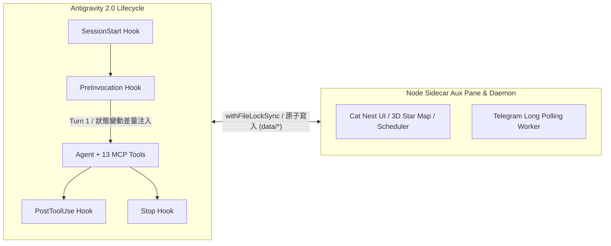

<div align="center">
  
  <h1>agy-gemini-chan</h1>
  <p><strong>Antigravity 2.0 專案限定 AI 伴侶與互動貓窩系統</strong></p>

  <p>
    <a href="https://github.com/Xuan52766/agy-gemini-chan/releases"></a>
    = 20.0.0" />
    
    <a href="./LICENSE"></a>
  </p>

  <p>
    <a href="#快速開始">快速開始</a> ·
    <a href="#版本升級與資料保護">版本升級</a> ·
    <a href="#系統架構與低-token-設計">系統架構</a> ·
    <a href="#mcp-工具與-skills">MCP 工具</a> ·
    <a href="#telegram-橋接與安全模型">Telegram 橋接</a> ·
    <a href="./使用手冊.md">使用手冊</a> ·
    <a href="./CHANGELOG.md">Changelog</a>
  </p>
</div>

> **派生聲明（[Yuuyuko-uu 插件許可 1.2](./LICENSE)）**
> 本專案派生自 **Yuuyuko-uu** 的 [`dsh-fish-memory`](https://github.com/Yuuyuko-uu/dsh-fish-memory)、[`dsh-feiyu-mood`](https://github.com/Yuuyuko-uu/dsh-feiyu-mood)、[`dsh-xingxi`](https://github.com/Yuuyuko-uu/dsh-xingxi)、[`dsh-speak-up`](https://github.com/Yuuyuko-uu/dsh-speak-up)，並整合 **huaizhuanghub** [`dsh-persona-dafeiyu`](https://www.npmjs.com/package/dsh-persona-dafeiyu)（MIT）與 [`jieba`](https://github.com/fxsjy/jieba) 詞表。
> 主要改動：移植為 Antigravity 2.0 原生架構（Hooks / MCP / Sidecar Web UI）、單一工作區隔離、差量低 Token 注入、免外部 API 心情評估、Telegram 雙向橋接與無損更新器（詳見[致謝與授權](#致謝與授權)）。

---

## 系統概覽

`agy-gemini-chan` 是純本機運行的 Antigravity 2.0 工作區伴侶外掛，基於 Node.js 標準庫實作（無 `node_modules`，無需外部 LLM API Key）。僅在 Antigravity 以本目錄作為主要工作區時啟用；切換至其他開發專案時自動維持靜默，不注入上下文也不消耗額外 Token。

| 模組 | 職責說明 | 核心實作 |
| :--- | :--- | :--- |
| **Cat Nest Sidecar** | 8 維情緒與睡眠立繪連動、支援自訂立繪上傳、懸停說明面板、羈絆等級 `Lv.X` 與陪伴暖度 | [`core/nest.mjs`](core/nest.mjs), [`sidecar/`](sidecar/) |
| **Fish Memory** | 本地分詞與專名滑動窗、Zipf 詞頻泛詞過濾、IDF 證據評分、半衰期 $H = 30(1 + 2I)$、`factKey` 收斂 | [`core/memory.mjs`](core/memory.mjs), [`core/tokenizer.mjs`](core/tokenizer.mjs) |
| **Mood Engine** | 對話內呼叫 `mood_update`（支援 `innerThought`）並於 `Stop` Hook 提供可選本地語意兜底 | [`core/mood.mjs`](core/mood.mjs) |
| **Xingxi Archive** | 八章 `記憶卡.md`、每日日記與增量拾星、智慧斷詞共詞橋與 3D 記憶星圖（原版／星團／隨機、章節聚光燈、年輪逐日誕生） | [`core/xingxi.mjs`](core/xingxi.mjs) |
| **Speak-Up & Fresh Browse** | `speak_up_plan` 預約排程／固定節律／自主勿擾、峰谷擲骰與選用每日新鮮事話題種子（RSS / YouTube / 台灣天氣） | [`core/speak-up.mjs`](core/speak-up.mjs), [`core/fresh-browse.mjs`](core/fresh-browse.mjs) |
| **Persona Store** | 雙層作用域（`session > project`）與 `.md` / `.txt` 匯入匯出（預設為空） | [`core/persona.mjs`](core/persona.mjs) |
| **Telegram Bridge** | 純 HTTPS Long Polling 雙向收發、`/bind` 配對鎖定與檔案外傳白名單 | [`core/telegram.mjs`](core/telegram.mjs) |

---

## 快速開始

### 環境需求

- Node.js `>= 20.0.0`
- Antigravity 2.0（支援 Workspace Plugins、MCP 與 Sidecar Aux Pane）

### 安裝與註冊

#### 透過 Git 安裝（推薦）

```bash
git clone https://github.com/Xuan52766/agy-gemini-chan.git
cd agy-gemini-chan
node scripts/setup-sidecar.mjs
```

#### 透過 Release 壓縮檔安裝（免 Git）

從 [Releases](https://github.com/Xuan52766/agy-gemini-chan/releases) 下載最新原始碼 `.zip` 並解壓至固定目錄，於該目錄執行 `node scripts/setup-sidecar.mjs`（Windows 若受 PowerShell `ExecutionPolicy` 阻擋，可直接雙擊 [`scripts/setup.cmd`](scripts/setup.cmd)）。

<details>
<summary><code>setup-sidecar.mjs</code> 註冊行為與 CLI 參數</summary>

- 將目前專案路徑同步寫入 `~/.gemini/config/plugins/gemini-cat/`（包含 `plugin.json`、`hooks.json`、`mcp_config.json`、`rules/AGENTS.md`、`skills/` 與 `sidecars/gemini_cat_nest/sidecar.json`），所有個人資料仍留在本專案 `data/` 下。
- `--dry-run`：預覽寫入路徑與設定，不實際修改檔案。
- `--force`：搬移或重新命名專案目錄後，備份舊設定 `.bak-*` 並更新路徑指向。
- `--config-dir <dir>`：指定自訂的 `.gemini/config` 路徑。

</details>

### 啟用與初始化設定

1. 在 Antigravity 2.0 將此目錄開啟為**第 1 個（主要）工作區**。
2. 於 **Customizations → Plugins** 確認 [`Gemini-chan 貓窩伴侶`](customization://gemini-cat) 已啟用，並自 **UI Extensions**（或 [`sidecar://gemini-cat/gemini_cat_nest/`](sidecar://gemini-cat/gemini_cat_nest/)）開啟側邊欄。
3. **設定人設**：為保持專案中立，`projectDefaultId` 預設為空；請先至貓窩「人設」分頁啟用內建中性範本或匯入 `.md` / `.txt` 角色設定。
4. **啟用主動搭話**：`dryRun` 預設為 `true`；調整好時段後，至「搭話」分頁取消勾選試運行即可正式觸發主動推播。
5. **設定 MCP 權限規則（建議）**：本插件提供 13 個本機伴侶 MCP 工具；建議在 Antigravity 權限規則將 `mcp(gemini-cat_companion/*)` 設為 `Allow`，避免日常使用或 Telegram 遠端對話期間遭到授權確認彈窗阻塞。

---

## 版本升級與資料保護

無論透過 Git 或 Release 壓縮檔安裝，皆可使用內建更新腳本直接升級至最新版，升級過程不會覆蓋個人資料或根目錄自訂規則：

```bash
# 跨平台與 PowerShell 安全指令（Windows 亦可雙擊 scripts\update.cmd）
node scripts/update.mjs
```

| 階段 | 機制說明 | 涵蓋範圍 |
| :--- | :--- | :--- |
| **版控隔離** | `.gitignore` 排除個人執行期資料與自訂規則 | `data/*`（僅保留 `data/dict/`）、`/AGENTS.md` |
| **升級前備份** | 自動建立完整快照並排除 `.lock` / `.tmp-*`，最多保留 5 份 | `~/.gemini/config/backups/agy-gemini-chan/upgrade-<timestamp>/` |
| **安全更新** | Git 版執行 `git pull --ff-only`；ZIP 版抓取最新 Release Tarball 僅覆蓋程式與詞表 | 保留 `data/fish-memory`、`mood`、`nest`、`persona`、`speak-up`、`telegram`、`xingxi`、`runtime` 與 `/AGENTS.md` |
| **自動對齊與驗證** | 自動呼叫 `setupSidecar` 更新外掛路徑並執行完整測試套件 | `~/.gemini/config/plugins/gemini-cat/` 與 `tests/*.test.mjs` |

<details>
<summary><code>update.mjs</code> 進階參數</summary>

| 參數 | 作用 |
| :--- | :--- |
| `--dry-run`, `-n` | 僅顯示更新模式與備份路徑，不寫入任何檔案 |
| `--stash` | Git 模式下若有未提交程式碼修改，自動 `git stash push` 後再更新 |
| `--force`, `-f` | ZIP 模式強制重新下載最新 Release，並強制同步 Sidecar 路徑 |
| `--skip-tests` | 升級完成後略過 `node --test tests/*.test.mjs` 驗證 |
| `--config-dir <dir>` | 指定自訂的 `.gemini/config` 目錄 |

</details>

升級完成後，請於 Antigravity **UI Extensions** 將「Gemini-chan 貓窩」關掉重開以重新啟動 Sidecar 背景行程；若曾於抽屜手動儲存自訂提示詞，系統會保留你的自訂內容，可視需要於抽屜點擊「恢復預設」。

---

## 系統架構與低 Token 設計



- **單次基底與差量注入**：人設全文、`記憶卡.md`（上限 20,000 字，超長時附 `xingxi` 全文提示）、近 7 日日記（上限 10,000 字）＋ 更早 23 日關鍵詞索引（上限 800 字）與規則指引僅於新對話第 1 輪或設定變更時由 `PreInvocation` 注入；其餘輪次無新召回記憶或狀態變動時回傳 `{}`（0 Token）。
- **工具續行過濾**：`inspectTranscriptTail` 與 `unwrapSidecarSystemEnvelope` 自動識別回合中 MCP 工具續行及 Antigravity `<SYSTEM_MESSAGE>` 外殼，避免重複注入系統提示。
- **跨行程獨佔檔案鎖**：Hooks、Sidecar Web UI 與 60 秒背景排程透過 `withFileLockSync` / `updateJsonLocked` 與 Windows atomic rename 重試保護併發狀態寫入（[`core/storage.mjs`](core/storage.mjs)）。

---

## MCP 工具與 Skills

- **Slash Skills**：`/xingxi`（記憶卡總覽、日記檢索與拾星歸檔）、`/cat-nest`（查看貓窩即時狀態、照護與睡眠切換）。
- **Stdio MCP Server（`gemini-cat_companion`）**：

<details open>
<summary>13 項原生 MCP 工具列表</summary>

| 類別 | 工具名稱 | 功能摘要 |
| :--- | :--- | :--- |
| **長期記憶** | `remember` | 寫入長期記憶，支援 `importance`、`tags`、`factKey`、`supersedes` |
| | `recall` | 依查詢句主動檢索記憶庫，不增加強化次數 |
| | `memory_forget` | 將指定 ID 標記為已被取代以停用召回（資料保留可復原） |
| **星汐系統** | `xingxi` | 通讀完整八章 `記憶卡.md` 並檢查重複章節 |
| | `xingxi_read` | 檢索記憶卡索引、指定日期日記（`date`）或關鍵詞搜尋（`keyword`） |
| | `xingxi_append` | 追加長期要點至第 1–8 章（自動去重；第 2 章支援 `wholeChapter` 防縮水） |
| | `xingxi_diary` | 寫入或追加 `日記/YYYY-MM-DD.md` 並推進整理進度 |
| | `xingxi_pickup` | 切出指定日期原始對話素材與摘要供歸檔寫入 |
| **心情與貓窩** | `mood_status` | 讀取大心情分數、8 維情緒、羈絆進度與現行人設摘要 |
| | `mood_update` | 更新本輪大心情、8 維情緒與第一人稱 `innerThought` |
| | `nest_interact` | 在對話中執行照護互動或作息切換（`pet`/`feed`/`play`/`comfort`/`nap`/`sleep`/`wake`） |
| **排程與外部** | `speak_up_plan` | 設定單次／批次預約、`add_routine`、自主勿擾（`silence`）與模組開關 |
| | `telegram_send` | 主動透過已綁定 Telegram Bot 發送文字、圖片或白名單內檔案 |

</details>

---

## Telegram 橋接與安全模型

- **純出站 Long Polling**：由 Sidecar 主動長輪詢 `api.telegram.org`，不需公網 IP、Port Forwarding 或反向代理。
- **綁定保護與速率限制**：配對碼由 `crypto.randomInt` 產生，單一來源 `/bind` 連續失敗 5 次鎖定 15 分鐘；預設啟用 `lockSingleChat`，首次綁定後阻擋第二支 Telegram 帳號接入，且 `POST /api/telegram/test` 在鎖定後僅限對已綁定對象傳送純文字測試。
- **輸入中和與檔案路徑驗證**：`neutralizeTelegramMarkers` 會跳脫外部訊息夾帶的內部系統標籤；`telegram_send` 與回覆附檔皆經 `realpathSync.native` 實體路徑解析（`isAllowedTelegramSendPath`），封鎖 `.env`、`*.pem` / `*.key`、`id_rsa*`、`credentials*.json`、`data/**/config.json`、`runtime/`、`.git/` 與任何 symlink / NTFS junction 跳脫。
- **桌面活躍自動靜音**：Antigravity 桌面端對話進行後的設定窗期內（預設 15 分鐘），非 Telegram 觸發的推播會依設定自動切換為 `skip` 或 `silent`；直接來自 Telegram 的提問回覆永遠即時傳回。

---

## 目錄結構與測試

```text
agy-gemini-chan/
├── .agents/plugins/gemini-cat/   # Antigravity Plugin 清單、Hooks、MCP、Skills 與 Sidecar 設定
├── assets/geminichan/            # Q 版情緒與睡眠立繪資源
├── core/                         # 領域模組（記憶、心情、星汐、搭話、新鮮事、人設、貓窩、Telegram、跨模組橋接）
├── hooks/                        # SessionStart / PreInvocation / PostToolUse / Stop 實作
├── mcp/                          # Stdio JSON-RPC 2.0 MCP Server（13 tools）
├── scripts/                      # setup-sidecar.mjs / update.mjs 與 Windows .cmd 啟動檔
├── sidecar/                      # Node HTTP Server 與貓窩 Aux Pane 前端
├── tests/                        # node:test 單元與整合測試套件
└── data/                         # 僅追蹤 data/dict/；個人執行期狀態由 .gitignore 排除
```

執行完整測試套件：

```bash
node --test tests/*.test.mjs
# 若 PowerShell 未封鎖執行原則亦可使用：
npm test
```

---

## 故障排除

- **開啟多個工作區時是否會誤觸或污染其他專案？**
  不會。`isProjectWorkspaceActive` 僅檢查 `workspaceList[0]`（第 1 個主要工作區）；當本專案作為輔助參考資料夾或切換至其他專案時，所有 Hooks 與 Sidecar 會維持 0 Token 靜默待機。
- **搬移或重新命名專案資料夾後 Sidecar 無法載入？**
  於新目錄執行 `node scripts/setup-sidecar.mjs --force`（或雙擊 `scripts\setup.cmd`）更新外掛指向即可。
- **升級後需要比對或還原升級前的資料？**
  前往 `~/.gemini/config/backups/agy-gemini-chan/upgrade-<timestamp>/` 即可取得升級前建立的完整 `data/` 與 `AGENTS.md` 快照。
- **長期累積的日記與對話紀錄會不斷拉高 Token 消耗嗎？**
  不會。歷史日記、原始切片與備份僅保存於本機硬碟，平時不進入上下文；僅首輪啟動會載入受長度上限約束的記憶卡（20,000 字）、近 7 日日記（10,000 字）與 23 日精簡關鍵詞索引（800 字）。

---

## 致謝與授權

本專案遵循並完整保留 **[Yuuyuko-uu 插件許可 1.2](./LICENSE)** 公開衍生（原 `dsh-xingxi` 另附 `1.1` 版條款），上游引用專案如下：

| 上游元件 | 原作者 | 原始倉庫 / 套件 | 對齊版本 / 授權 |
| :--- | :--- | :--- | :--- |
| 長期記憶 | Yuuyuko-uu | [`Yuuyuko-uu/dsh-fish-memory`](https://github.com/Yuuyuko-uu/dsh-fish-memory) | `v1.6.3` · [Yuuyuko-uu 1.2](./LICENSE) |
| 心情引擎 | Yuuyuko-uu | [`Yuuyuko-uu/dsh-feiyu-mood`](https://github.com/Yuuyuko-uu/dsh-feiyu-mood) | `v0.9.6` · [Yuuyuko-uu 1.2](./LICENSE) |
| 星汐記憶卡與星圖 | Yuuyuko-uu | [`Yuuyuko-uu/dsh-xingxi`](https://github.com/Yuuyuko-uu/dsh-xingxi) | `v0.3.8` · Yuuyuko-uu 1.1 / 1.2 |
| 主動搭話 | Yuuyuko-uu | [`Yuuyuko-uu/dsh-speak-up`](https://github.com/Yuuyuko-uu/dsh-speak-up) | `v0.3.3` · [Yuuyuko-uu 1.2](./LICENSE) |
| 雙層作用域人設 | huaizhuanghub | [`dsh-persona-dafeiyu`](https://www.npmjs.com/package/dsh-persona-dafeiyu) | MIT License |
| 中文分詞詞表 | fxsjy | [`jieba`](https://github.com/fxsjy/jieba)（[`LICENSE-dict.txt`](data/dict/LICENSE-dict.txt)） | MIT License |

<details>
<summary>完整平台移植與修改明細（依許可條款第 5 條第 c 項列明）</summary>

1. **運行平台重構**：由 DSH / Cordis 插件架構移植為 Antigravity 2.0 原生 Plugin（`hooks.json`、Stdio MCP Server、Skills 與 `sidecar_sdk` Web UI），並以 `injectedPersonaHash`＋`inspectTranscriptTail`＋`unwrapSidecarSystemEnvelope` 實作差量注入。
2. **單一工作區隔離與雙層人設**：收斂全域切換設計為「單一對話覆寫 ＞ 專案共用」雙層架構，於 Hooks、MCP 與 Sidecar 推播入口實作主要工作區與已登記對話驗證（[`core/bridge.mjs`](core/bridge.mjs)、[`core/storage.mjs`](core/storage.mjs)）。
3. **對話內零外部 API 心情評估**：改由現行對話內模型呼叫 `mood_update`（支援第一人稱 `innerThought`）搭配 `Stop` Hook 本地語意分析兜底。
4. **擴充伴侶體驗與工程維運**：新增「Gemini-chan 貓窩」Q 版情緒立繪、羈絆暖度系統、跨行程獨佔檔案鎖、Telegram Long Polling 安全橋接，以及非破壞性安裝腳本（[`scripts/setup-sidecar.mjs`](scripts/setup-sidecar.mjs)）與自動備份無損更新器（[`scripts/update.mjs`](scripts/update.mjs)）。

</details>
