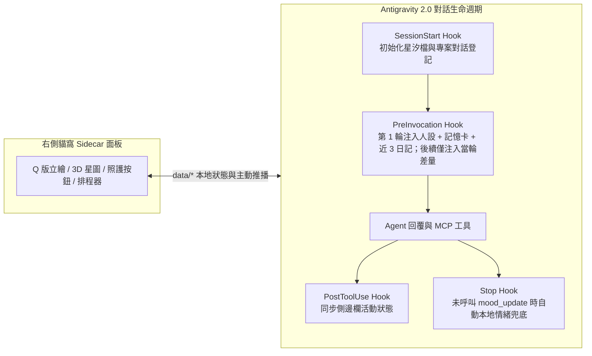

# agy-gemini-chan｜Gemini-chan 貓窩

<p align="center">
  
</p>

<p align="center">
  <strong>Antigravity 2.0 專案限定 AI 伴侶與互動貓窩系統</strong><br/>
  <span>版本：<code>v1.2.1</code> ・ <a href="./CHANGELOG.md">更新紀錄</a> ・ <a href="./使用手冊.md">完整使用手冊</a> ・ <a href="./LICENSE">授權條款</a></span>
</p>

---

## 專案簡介

**`agy-gemini-chan`** 是專為 **Antigravity 2.0** 打造的本地端 AI 伴侶與互動側邊欄系統。透過原生 **Plugin Lifecycle Hooks**、**Stdio MCP Server**、**Skills** 與 **Sidecar Aux Pane Web UI** 整合，無須額外申請外部 LLM API Key，即可在指定工作區內提供：

- **Q 版互動貓窩側邊欄**：即時情緒立繪切換、照護互動、羈絆等級與今日陪伴暖度。
- **雙軌長期記憶**：結合「艾賓浩斯淡忘曲線記憶庫」與「星汐八章記憶卡＋每日日記＋3D 記憶宇宙星圖」。
- **對話內 8 維情緒感知**：依真實對話互動自然起伏並影響回覆語氣，搭配回合末零 Token 本地兜底。
- **主動搭話排程**：支援自訂週幾、跨午夜峰谷時段、安靜時段與連沒中保底加成。
- **嚴格工作區隔離**：所有 Hooks、人設與主動推播僅在本專案工作區內生效，切換至其他開發專案自動保持靜默。

---

## 核心功能

| 模組 | 功能說明 | 核心實作 |
| :--- | :--- | :--- |
| **Gemini-chan 互動貓窩** | 依大心情與睡眠狀態自動切換 6 款 Q 版立繪；提供摸頭、餵小魚乾、逗貓棒、貼貼、打盹／叫醒與遞小紙條互動；採用**羈絆進度（`Lv.X`）＋今日陪伴暖度**設計（無飽食／精力倒扣懲罰，單日達成 3 種互動另有羈絆加成） | [core/nest.mjs](core/nest.mjs)<br>[sidecar/](sidecar/) |
| **艾賓浩斯長期記憶** | 本地中文詞典切詞＋連續單字專有名詞滑動窗（`補專名`）、說話尺 IDF 證據評分、鮮活度指數半衰期 $H = 30 \times (1 + 2I)$、15 輪防重複注入窗（`repeatWindow`）、`factKey` 事實鍵自動收斂與常駐檔案支援 | [core/memory.mjs](core/memory.mjs)<br>[core/tokenizer.mjs](core/tokenizer.mjs) |
| **8 維情緒感知引擎** | 免外部 API Key 混成判定：發生明確情緒事件時由對話內模型呼叫 `mood_update`，日常微幅波動由 `Stop` 鉤子本地分析兜底；含大心情（`0–100`）、8 維情緒（含 45 分鐘快消氣的「生氣」與路人話題 `other` 歸零保護） | [core/mood.mjs](core/mood.mjs) |
| **星汐記憶卡與 3D 星圖** | 八章結構 `記憶卡.md`＋`日記/YYYY-MM-DD.md`＋清潔標籤後的 `原始對話/`；支援每日定時與錯過自動補跑「拾星」、`.bak` 自動備份還原，以及含球心核心星、共詞橋與「年輪」時間軸播放的 **3D 記憶宇宙星圖** | [core/xingxi.mjs](core/xingxi.mjs) |
| **主動搭話排程器** | 支援自訂週幾、跨午夜峰谷時段、時區、安靜時段、冷卻時間、時機因子與連沒中保底加成；預設開啟 `dryRun` 試運行模式，確認節奏後可隨時切換為真實搭話 | [core/speak-up.mjs](core/speak-up.mjs) |
| **雙層隔離人設庫** | 採用 **「單一對話覆寫 ＞ 專案共用 ＞ 內建中性陪伴範本」** 架構；支援側邊欄即時編修、改名、單筆啟停與 `.md`/`.txt` 匯入匯出 | [core/persona.mjs](core/persona.mjs) |

---

## 快速安裝與啟用

### 環境需求
- **Node.js `>= 20.0.0`**
- **Antigravity 2.0**（支援 Workspace Plugin 與 Aux Pane Sidecar）

### 1. 下載專案並註冊 Plugin 與 Sidecar
```bash
git clone https://github.com/Xuan52766/agy-gemini-chan.git
cd agy-gemini-chan
npm run setup
```
> `npm run setup`（即 `node scripts/setup-sidecar.mjs`）會自動將你電腦上這個資料夾的實際路徑註冊至 `~/.gemini/config/plugins/gemini-cat/`（包含插件清單、左紅右黃異色瞳貓貓圖示 `logo.svg`、Hooks、MCP 與內建 `sidecars/gemini_cat_nest/sidecar.json`），並自動清理舊版獨立設定。若目標已存在且路徑不同，可加上 `--force` 自動備份 `.bak-*` 後更新，或加 `--dry-run` 預覽。

<details>
<summary>手動檢視 <code>sidecar.json</code> 結構範例（選用）</summary>

檔案位置：`~/.gemini/config/plugins/gemini-cat/sidecars/gemini_cat_nest/sidecar.json`（Windows 為 `%USERPROFILE%\.gemini\config\plugins\gemini-cat\sidecars\gemini_cat_nest\sidecar.json`）

```json
{
  "command": "node",
  "args": ["/path/to/your/agy-gemini-chan/sidecar/main.mjs"],
  "restart_policy": "always",
  "display_name": "Gemini-chan 貓窩",
  "description": "Gemini-chan 互動貓窩側邊欄：即時情緒立繪、長期記憶庫、星汐星圖與主動搭話（僅在目前專案工作區生效）。",
  "has_web_ui": true,
  "agent_permissions": {
    "allows_user_interactions": false
  },
  "ui_config": {
    "display_name": "Gemini-chan 貓窩",
    "views": [
      {
        "path": "/",
        "entrypoint": "SIDECAR_UI_ENTRYPOINT_AUX_PANE",
        "title": "Gemini-chan 貓窩"
      }
    ]
  }
}
```
</details>

### 2. 開啟專案工作區與側邊欄面板
1. 在 Antigravity 2.0 **將下載下來的資料夾當作專案（Project / Workspace）開啟**（不限資料夾名稱，系統會自動認得該目錄並啟用伴侶機制）。
2. 在 **Customizations → Plugins**（或點擊 `[Gemini-chan 貓窩伴侶](customization://gemini-cat)`）可一鍵開關整個插件；並從 **Extensions → Gemini-chan 貓窩**（或對話中點擊 `[打開 Gemini-chan 貓窩](sidecar://gemini-cat/gemini_cat_nest/)`）喚出右側貓窩面板。

### 3. 選擇或匯入人設
1. 切換至右側貓窩面板的 **「人設」** 分頁。
2. 點擊 **「設為本專案」** 啟用內建中性陪伴範本，或新增／匯入自訂的 `.md`、`.txt` 角色設定。

### 4. 開始對話與互動
- 開啟新對話即可自動載入星汐記憶卡、近期日記與人設。
- 可隨時點擊貓窩的「摸頭」、「小魚乾」、「逗貓棒」、「貼貼」、「打盹」或「傳小紙條」與對話連動。
- 如需啟用定時主動搭話，可至 **「搭話」** 分頁調整時段並取消勾選「試運行模式」。

---

## 對話指令與 MCP 工具一覽

### 內建 Slash Skills
- `/xingxi`：通讀星汐八章記憶卡、檢索過往日記或執行今日對話拾星歸檔。
- `/cat-nest`：查看貓窩即時狀態、心情維度或在對話中進行照護互動。

### 原生 MCP 工具（`gemini-cat_companion`）

| 工具名稱 | 用途說明 |
| :--- | :--- |
| `remember` | 將值得長期保留的事實、偏好、約定寫入長期記憶（支援 `importance`、`factKey`、`supersedes`） |
| `recall` | 依關鍵句主動檢索長期記憶庫（不影響記憶強化次數） |
| `memory_forget` | 將指定 ID 的舊記憶標記為「已被取代」收起 |
| `xingxi` | 通讀完整 `記憶卡.md` 八章內容並檢查重複章節 |
| `xingxi_read` | 檢索記憶卡、指定日期日記（`date`）或全文搜尋（`keyword` / `file`） |
| `xingxi_append` | 將長期要點追加至 `記憶卡.md` 第 1～8 章（自動去重與備份；第 2 章支援防縮水整章合併） |
| `xingxi_diary` | 寫入或追加指定日期的日記（`日記/YYYY-MM-DD.md`）並推進整理進度 |
| `xingxi_pickup` | 從本專案對話紀錄切出當日原始對話素材與記憶／心情摘要，供拾星歸檔使用 |
| `mood_status` | 讀取目前大心情、8 維情緒、貓窩羈絆進度／今日陪伴與生效人設摘要 |
| `mood_update` | 於發生明確情緒轉折時記錄心情與 8 維情緒變化（支援 `subject: owner \| self \| other \| none`） |
| `nest_interact` | 在對話中執行貓窩照護或切換睡眠／喚醒狀態（`pet` / `feed` / `play` / `comfort` / `nap` / `sleep` / `wake`） |

---

## 運作架構與低 Token 設計



- **單次基底注入、每輪差量更新**：人設全文、星汐啟動包（記憶卡＋近 3 日日記）與靜態規則僅在新對話第 1 輪（或中途切換人設）由 `PreInvocation` 注入一次；後續回合若無新命中的記憶、顯著心情變化或待處理的貓窩互動，`PreInvocation` 直接回傳 `{}`（**0 Token 注入**）。
- **工具續行自動跳過**：模型在回合中呼叫 MCP 工具後的續行推理（Mid-turn continuation）會由 `inspectTranscriptTail` 自動識別並跳過，不重複塞入上下文。
- **本機資料完全隔離**：所有個人設定、記憶、日記與對話切片均存放於 `data/`（已由 `.gitignore` 排除，僅保留 `data/dict/` 公開分詞詞表），不會隨 Git 提交外洩，也不會在平時佔用對話 Token。

更多公式細節、參數說明與開發維護指南請參閱 **[使用手冊.md](./使用手冊.md)**。

---

## 常見問題（FAQ）

<details>
<summary><strong>Q1：在 Customizations → Plugins 關掉開關會發生什麼事？切到別的專案會被干擾嗎？</strong></summary>

執行 `npm run setup` 後，`Gemini-chan 貓窩伴侶` 會出現在 **Customizations → Plugins** 列表中，你可以隨時一鍵開關整個插件（含 Hooks、MCP 工具、Skills 與貓窩側邊欄）。而當插件保持開啟、你切換去其他程式專案時，所有 Hooks 與 Sidecar 都會透過 `isProjectWorkspaceActive` 自動進入靜默待機，對外部專案維持 **0 規則外洩、0 Token 消耗**。
</details>

<details>
<summary><strong>Q2：放在專案裡的記憶檔、日記或說明文件會讓對話 Token 變多嗎？</strong></summary>

不會。一般檔案與 `data/` 下的歷史日記、原始對話切片、備份檔平時保存在硬碟中 **0 Token 消耗**；僅有新對話第 1 輪 `PreInvocation` 啟動注入時會讀取 `記憶卡.md`（上限 4,200 字）與最近 3 天日記（上限 2,400 字），更早的檔案只有在呼叫 `xingxi_read` 檢索時才會按需讀取。
</details>

<details>
<summary><strong>Q3：搬移或重新命名專案資料夾後需要做什麼？</strong></summary>

核心模組皆使用相對路徑動態解析專案根目錄；搬移資料夾後，只需在新的目錄下執行一次 `node scripts/setup-sidecar.mjs --force` 更新 Sidecar 路徑即可。
</details>

---

## 開發與測試

```bash
npm test
```

---

## 致謝與授權聲明

本專案派生並改寫自以下開源專案，特此感謝原作者之創作並依各自授權條款公開分享：

1. **[Yuuyuko-uu](https://github.com/Yuuyuko-uu)** 開發之 DSH 伴侶插件系列——依 **[Yuuyuko-uu 插件許可 1.2](./LICENSE)**（其中 `dsh-xingxi` 原倉庫另附 `1.1` 版條款）進行跨平台移植與公開衍生：
   - 長期記憶：[`dsh-fish-memory`](https://github.com/Yuuyuko-uu/dsh-fish-memory)（對齊至 `v1.6.3`）
   - 心情引擎：[`dsh-feiyu-mood`](https://github.com/Yuuyuko-uu/dsh-feiyu-mood)（對齊至 `v0.9.6`）
   - 星汐記憶卡與日記星圖：[`dsh-xingxi`](https://github.com/Yuuyuko-uu/dsh-xingxi)（對齊至 `v0.3.8`）
   - 主動搭話：[`dsh-speak-up`](https://github.com/Yuuyuko-uu/dsh-speak-up)（對齊至 `v0.3.3`）
2. **[huaizhuanghub](https://github.com/huaizhuanghub)** 開發之人設管理插件 **[`dsh-persona-dafeiyu`](https://www.npmjs.com/package/dsh-persona-dafeiyu)**（MIT License）——參考並移植其分層作用域人設設計。
3. 中文分詞詞表 [`data/dict/`](data/dict/) 沿用 **[jieba](https://github.com/fxsjy/jieba)** 詞典（MIT License，詳見 [data/dict/LICENSE-dict.txt](data/dict/LICENSE-dict.txt)）。

<details>
<summary>相較原版 DSH 插件之平台移植與修改說明（依許可條款標示）</summary>

1. **運行平台重構**：由 DSH / Cordis 架構移植為 Antigravity 2.0 原生 Plugin（`hooks.json`、Stdio MCP Server、Skills 與 `sidecar_sdk` Web UI），並以差量注入機制（`injectedPersonaHash` ＋ `inspectTranscriptTail`）避免在 Antigravity 對話紀錄中重複累積上下文。
2. **單一工作區隔離**：將原版支援全域切換之人設收斂為「單對話覆寫 ＞ 專案共用」雙層架構，並在 Hooks、MCP 與 Sidecar 推播入口加入工作區邊界與已登記對話驗證（[core/bridge.mjs](core/bridge.mjs)）。
3. **對話內零外部 API 心情評分**：改由現行對話內模型呼叫 `mood_update` 搭配 `Stop` Hook 本地語意分析兜底，無須額外設定外部 API Key。
4. **新增「Gemini-chan 貓窩」伴侶視覺與羈絆系統**：新增 Q 版情緒／睡眠立繪切換、羈絆等級與今日陪伴暖度累積、打盹與自然喚醒同步，以及非破壞性 Sidecar 安裝腳本（[scripts/setup-sidecar.mjs](scripts/setup-sidecar.mjs)）。
</details>
